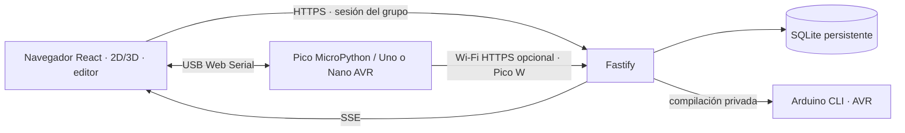

# Proyecto y arquitectura

Raíces Digitales combina una interfaz de taller React, escenas Three.js, una API Fastify, SQLite persistente, firmware de placa y un compilador Arduino separado. Su ruta guiada conecta las actividades físicas con datos reales y etiqueta los datos de práctica como simulación.

El navegador es dueño de las operaciones USB autorizadas. En Pico ejecuta MicroPython raw REPL y escribe módulos/configuración; en Arduino solicita HEX al compilador y habla STK500v1 con el bootloader. Pico puede publicar por USB a través del navegador. Los modelos Pico W también pueden publicar por HTTPS; Uno/Nano no tienen radio y usan el puente USB del navegador.

Módulos clave:

- `web/content/`: actividades y etapas.
- `web/circuit/`: coordenadas, componentes y conexiones utilizadas por planos 2D y 3D.
- `web/experience/`: escenas interactivas y fallback.
- `web/lib/`: API, estado, progreso, Web Serial y uploads.
- `shared/boards.ts`: perfiles canónicos de placa.
- `server/`: rutas, autorización, persistencia, alertas y compilación.
- `firmware/`: drivers MicroPython y estación Arduino.

Detalles de sesiones, telemetría, firmware y cola de compilación: [arquitectura](https://github.com/crismoraga/Taller-IoT-v2-Raices-Digitales/blob/main/docs/ARCHITECTURE.md), [contrato API](https://github.com/crismoraga/Taller-IoT-v2-Raices-Digitales/blob/main/docs/IMPLEMENTATION_CONTRACT.md) y [seguridad](https://github.com/crismoraga/Taller-IoT-v2-Raices-Digitales/blob/main/docs/SECURITY.md).
